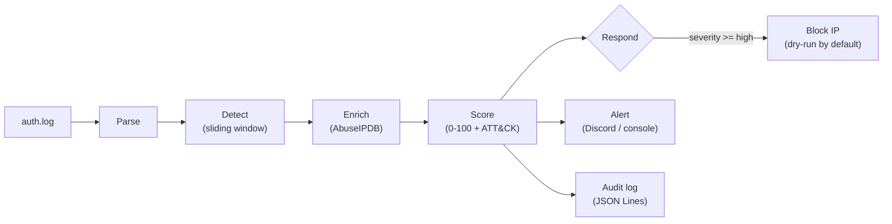

# SSH Brute-Force Responder

A small SOC automation tool that turns a raw SSH auth log into triaged, explained, actionable incidents, the way a SOC analyst would handle them, but in seconds.

**Detect → Enrich → Score → Respond → Alert → Audit**

1. **Detect** brute-force attacks with a sliding-window rule, and flag a possible compromise when a login succeeds from the attacker's IP afterwards.
2. **Enrich** the source IP with [AbuseIPDB](https://www.abuseipdb.com/) reputation data (cached, rate-limit aware).
3. **Score** each incident from 0 to 100, with every point explained, and map it to MITRE ATT&CK.
4. **Respond** by generating (dry-run, the default) or applying a firewall block for serious incidents.
5. **Alert** on Discord with a colour-coded embed, and print a readable report to the console.
6. **Audit** every decision to a JSON Lines file.



## Quick start

Requires Python 3.10+. Works on any OS for detection and alerting; applying blocks needs Linux with `ufw` or `iptables`.

```bash
git clone https://github.com/Smaak01/ssh-bruteforce-responder.git
cd ssh-bruteforce-responder
python -m venv .venv && source .venv/bin/activate   # Windows: .venv\Scripts\activate
pip install -r requirements.txt

# Try it on the included sample log (no API keys needed)
python -m sshresponder --log samples/auth.log --year 2026 --no-enrich
```

### Optional: enable enrichment and Discord alerts

```bash
cp .env.example .env     # then fill in the two values
```

| Variable | Where to get it |
|---|---|
| `ABUSEIPDB_API_KEY` | Free key at <https://www.abuseipdb.com/account/api> |
| `DISCORD_WEBHOOK_URL` | Discord: Server Settings → Integrations → Webhooks → New Webhook → Copy URL |

### Run it on a real server

```bash
# 1. Always look first. This is a dry run and changes nothing.
python -m sshresponder --log /var/log/auth.log

# 2. When you trust the output, let it apply blocks (needs root for ufw/iptables)
sudo python -m sshresponder --log /var/log/auth.log --enforce --allowlist 203.0.113.7,198.51.100.0/24
```

## Example output

Running the demo on `samples/auth.log` (299 log lines, four simulated attackers and one legitimate user who mistypes a password):

```text
sshresponder 1.0.0 | mode: DRY-RUN (no changes will be made)
Enrichment: disabled (--no-enrich)
Discord alerts: disabled (set DISCORD_WEBHOOK_URL in .env to enable)
Parsed 102 sshd auth events (99 failed, 3 accepted) from samples/auth.log

[CRITICAL] 203.0.113.45  risk 95/100
  attempts   : 41 failed logins in 88s (starting 2026-10-15 02:14:03)
  usernames  : admin, ftpuser, guest, oracle, postgres, root, test, ubuntu (+1 more) (9 distinct)
  reputation : enrichment disabled
  !! COMPROMISE: successful login as 'ubuntu' from this IP after the attack
  MITRE      : T1110 Brute Force, T1078 Valid Accounts
  why        : 41 failed logins (+30); mostly non-existent usernames, typical of automated guessing (+10); 9 different usernames tried (+10); privileged account targeted (+5); successful login from the same IP after the attack (+40)
  action     : dry-run: would run: ufw deny from 203.0.113.45 to any port 22 proto tcp

[HIGH] 192.168.1.50  risk 55/100
  ...
  action     : skipped: internal address, never auto-blocked

[MEDIUM] 198.51.100.23  risk 45/100
  ...
  action     : none: severity medium is below the block threshold (high)

[LOW] 198.51.100.77  risk 10/100
  ...
  action     : none: severity low is below the block threshold (high)

Summary: 4 incident(s) [1 critical, 1 high, 1 medium, 1 low] | Discord alerts sent: 0 | blocks: 0 applied, 1 dry-run, 0 failed
```

Things worth noticing: the user who mistyped their password twice raised no incident, the internal host was detected but protected from auto-blocking, and the one attacker who got in is escalated to critical.

## How it works

### Detection

An incident is raised when one source IP produces **5 or more failed logins within 120 seconds** (`--threshold`, `--window`). Later failures from the same IP join the same incident until it stays quiet for a full window. If a login **succeeds** from that IP within 10 minutes of the attack, the incident is flagged as a possible compromise.

Only real credential failures count: `Failed password`, `Failed publickey` and similar. Noise such as `Invalid user`, pre-auth disconnects, and `Failed none` probes is ignored so attempts aren't double counted.

### Scoring

| Signal | Points |
|---|---|
| Failed logins: 5-9 / 10-29 / 30-99 / 100+ | 10 / 20 / 30 / 40 |
| Mostly non-existent usernames (≥ 50% of attempts) | +10 |
| 5 or more distinct usernames tried | +10 |
| Privileged account targeted (`root`, `admin`, `administrator`) | +5 |
| AbuseIPDB abuse confidence | 30% of the confidence value (up to +30) |
| Successful login after the attack | +40 |

Severity: **critical** ≥ 80, **high** ≥ 55, **medium** ≥ 30, otherwise **low** (the score is capped at 100). The `why` line lists every contribution, so the score is never a black box.

### MITRE ATT&CK mapping

| Technique | When |
|---|---|
| [T1110 Brute Force](https://attack.mitre.org/techniques/T1110/) | Every incident |
| [T1078 Valid Accounts](https://attack.mitre.org/techniques/T1078/) | A login succeeded after the attack |

### Response policy

| Severity | Default behaviour |
|---|---|
| ≥ `--alert-min` (medium) | Discord alert (if configured) |
| ≥ `--block-min` (high) | Block the source IP, **dry-run unless `--enforce`** |
| Anything lower | Logged in the report and audit file only |

## Safety by design

Automated response can do damage, so the guardrails are part of the design:

- **Dry-run by default.** Nothing touches the firewall unless you pass `--enforce`.
- **Internal addresses are never blocked** (RFC 1918, loopback, link-local, ULA) and are never sent to a third-party API.
- **Allowlist** (`--allowlist`) for IPs and CIDR ranges that must never be blocked, such as your own.
- **No shell, no injection.** Firewall commands are built as argument lists from a validated IP address, never from raw log text. A log line cannot smuggle in extra arguments.
- **Untrusted log data is sanitised.** Usernames are attacker-controlled, so they are stripped of terminal escape codes and markdown before being printed or posted, and Discord messages are sent with mentions disabled so a username like `@everyone` can't ping your server.
- **Failures degrade gracefully.** A dead API, rate limit or bad key never stops detection or alerting, and API keys never appear in output.
- **Discord URLs are validated** so alerts can only go to a real Discord webhook.

## Options

```text
--log PATH           sshd auth log to analyse (required)
--threshold N        failed logins in the window that raise an incident (default 5)
--window SECONDS     sliding window length (default 120)
--year YYYY          year for classic syslog timestamps, which omit it (default: current year)
--no-enrich          skip AbuseIPDB lookups
--alert-min LEVEL    lowest severity sent to Discord (default medium)
--block-min LEVEL    lowest severity that triggers a block (default high)
--firewall ufw|iptables   firewall used for blocks (default ufw)
--port N             SSH port to block (default 22)
--allowlist LIST     comma-separated IPs/CIDRs that must never be blocked
--enforce            actually apply blocks (default: dry-run)
--output FILE        write incidents as JSON Lines (audit log)
```

## Project layout

```text
sshresponder/
  parser.py      sshd log lines -> AuthEvent (classic syslog and ISO-8601 timestamps, IPv4/IPv6)
  detector.py    sliding-window detection and compromise correlation
  enrichment.py  AbuseIPDB client with on-disk cache and graceful failure handling
  scoring.py     explainable 0-100 risk score, severity, MITRE mapping
  responder.py   block policy, safe command building, dry-run/enforce
  notifier.py    console report and Discord webhook alerts
  cli.py         command-line entry point
tests/           86 unit and end-to-end tests (no network required)
samples/         auth.log with four simulated attackers
scripts/         generate_sample_log.py (regenerates the sample deterministically)
```

## Testing

```bash
pip install -r requirements-dev.txt
pytest
```

Tests mock all network and firewall calls, so they are safe to run anywhere. CI runs them on Python 3.10-3.13 and executes the demo on every push.

## Limitations and roadmap

- **Stateless:** every run re-reads the whole log, so re-running on the same file will re-alert on the same incidents. Next step: remember processed incidents (SQLite) so only new ones alert.
- **Batch, not live:** analyses a file once. A `--follow` mode that tails the log in real time is the natural next step.
- **SSH only:** other sources (web server logs, Wazuh/Suricata alerts) would plug in as additional parsers.
- **Single detection rule:** adding port-scan and password-spraying detectors would round out the coverage.
- **Reputation from one source:** a second enrichment source (VirusTotal, GeoIP) would improve scoring.

## Ethical use

This is a defensive tool. Only run it against logs and servers you own or are authorised to administer. The sample data uses documentation-only IP ranges (RFC 5737), so no real host is involved.

## License

[MIT](LICENSE)
